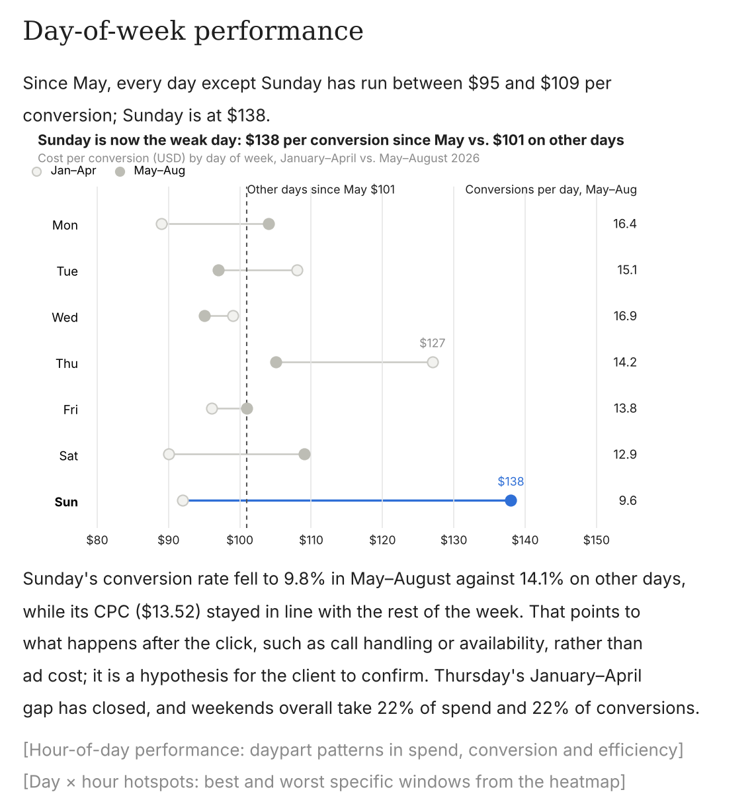
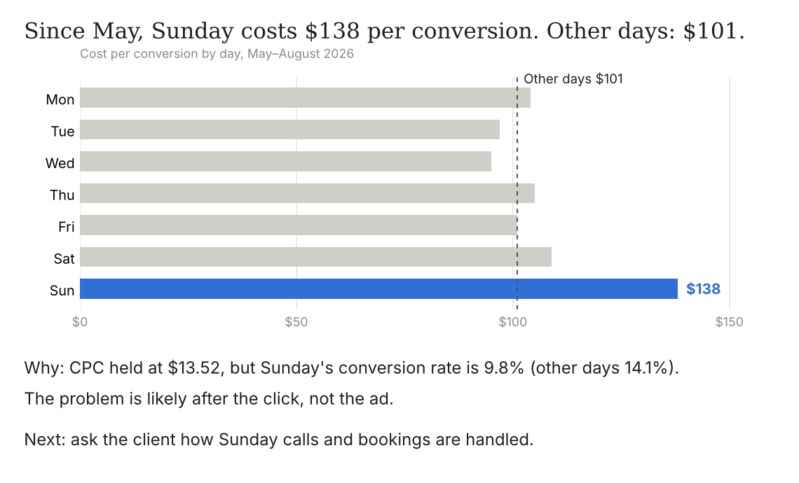

# noro

**Paid-media reports where every number is traced.**

noro is an open-source framework that turns a raw ad-platform export into a short report a client or exec can act on. It also audits and rewrites reports someone already wrote. It runs on your machine with your own OpenRouter key.

| Before | After |
| --- | --- |
|  |  |
| About 95 words plus a two-period chart | About 45 words and one chart |

## The rule: the model never does arithmetic

Code computes every number into a facts table. The writing model only ever sees fact ids and labels, writes `{{f12}}` where a number goes, and code fills in the value. A number in the report that doesn't trace to a fact fails the run.

## Quickstart

You need Node 22.19+ (Node 24 recommended) and Python 3.9+.

```bash
git clone https://github.com/noro-to/noro && cd noro
npm ci
npm run build
cp .env.example .env        # then put your OpenRouter key in .env
npx noro this fixtures/exports/google-ads.csv
```

`fixtures/exports/` holds synthetic Google Ads, Meta and Amazon DSP exports to try it on. Point it at your own export, or at a report you already have:

```bash
npx noro this ~/Downloads/campaign-report.csv
npx noro this weekly-update.md --format slack
```

Flags: `--format slack|email|one-page|slide-notes`, `--yes` to keep every flag without asking, `--json` for the report as JSON, `--accept-warnings` to go on when the export looks wrong (a cost column that looks like micros stops the run before any model call otherwise). Ingest warnings are printed to stderr and included in `--json`. Exit codes: 0 delivered, 2 the report can't pass the check, 1 a usage or input error.

## How it works

`noro this` runs seven steps. Each one is a checkpointed phase on [Pi Durable](https://github.com/earendil-works/pi/tree/main/packages/durable), so a run that's killed partway resumes where it stopped the next time you run the same command.

1. **Ingest** (code). Parse the CSV or XLSX and map its columns to one standard schema with the platform adapter.
2. **Compute** (code). Build the facts table: every metric, week-over-week change, share, sample size and baseline, each with an id, a formula and its inputs.
3. **Classify** ([jev](https://openrouter.ai/docs/guides/community/jev), `typesafe/jev-1.13`). Label each fact signal, noise or luck risk, with a priority and the watchouts that apply. Code can only make a label more cautious.
4. **Draft** (your writing model). Write the report with fact ids only.
5. **Check** (the rules engine). Trace every number to the facts table and run the 100 rules for slop, shaky claims and chart junk.
6. **Panel**. Reviewer personas read the draft as its reader would; their notes are applied or come to you as flags.
7. **Deliver**. You keep, cut or reword each flag, and get the final version.

A written report (`.md` or `.txt`) enters at step 5 in revision mode: its numbers become facts, and the rewrite has to be shorter and trace back to them.

Writing (draft, panel, revision) defaults to `anthropic/claude-opus-5.5`. Change `NORO_DRAFT_MODEL` and `NORO_PANEL_MODEL` in `.env` to use any OpenRouter model.

## Writing on your Claude subscription

If you have Claude Code installed and logged in with a Claude Pro or Max plan, you can run the writing steps on that instead of paying per token:

```bash
# .env
OPENROUTER_API_KEY=sk-or-...   # still used for jev (classify)
NORO_WRITER=claude-cli
```

noro then runs your own `claude -p` for each writing call, with no tools and no customizations. It never reads, stores or passes your Claude login, removes any Anthropic API key or cloud-provider settings from that call so it can't bill elsewhere, and stops unless `claude auth status` shows a subscription login.

This is for your own use, on your own machine, with your own account. Anthropic's [usage policy](https://code.claude.com/docs/en/legal-and-compliance) doesn't let products route other people's requests through Free, Pro or Max plans, and plan limits assume ordinary individual use. If you run noro for others, use `NORO_WRITER=openrouter`.

## Platforms

Google Ads, Meta and Amazon DSP ship as adapters in [`src/adapters/`](src/adapters/). Any other export goes through a column-guessing step that you confirm. The standard schema is in [docs/schema.md](docs/schema.md); it's a draft and the exact fields are still open.

Adding a platform is one YAML file. See [CONTRIBUTING.md](CONTRIBUTING.md).

## Roadmap

Coming soon:

- Scheduled reports (weekly and monthly)
- Live API connections to Google Ads, Meta and Amazon DSP
- Event triggers: a jev detector notices a CPA jump or a spend spike and wakes an agent

## Repository

- `src/`: the TypeScript pipeline (`ingest`, `adapters`, `compute`, `classify`, `draft`, `check`, `panel`, `deliver`, `harness`, `cli.ts`)
- `engine/`: the Python rules engine (`noro.py`, `rules.json`), called by the check step. Contract in [SPEC.md](SPEC.md)
- `rules/`: one YAML file per rule. `personas/` and `reference/`: the panel and the writing guides
- `fixtures/`, `bench/corpus/`, `examples/`: synthetic data only
- `tests/`: Python (`tests/engine`, `tests/rules`) and vitest (`tests/ts`)

```bash
npm test                                         # TypeScript, models mocked, no key needed
python -m unittest discover -s tests/engine -v   # engine
python -m unittest discover -s tests/rules -v    # rules
```

## Contributing

Adapters, rules and personas are each one file. See [CONTRIBUTING.md](CONTRIBUTING.md).

## Credits

Some guardrails were inspired by [marketingskills](https://github.com/coreyhaines31/marketingskills) (MIT) and the [report-builder](https://github.com/anthropics/knowledge-work-plugins/tree/main/small-business/skills/report-builder) skill in Anthropic's knowledge-work-plugins (Apache-2.0).

## License

[MIT](LICENSE). Made by noro contributors at [noro.to](https://noro.to).
